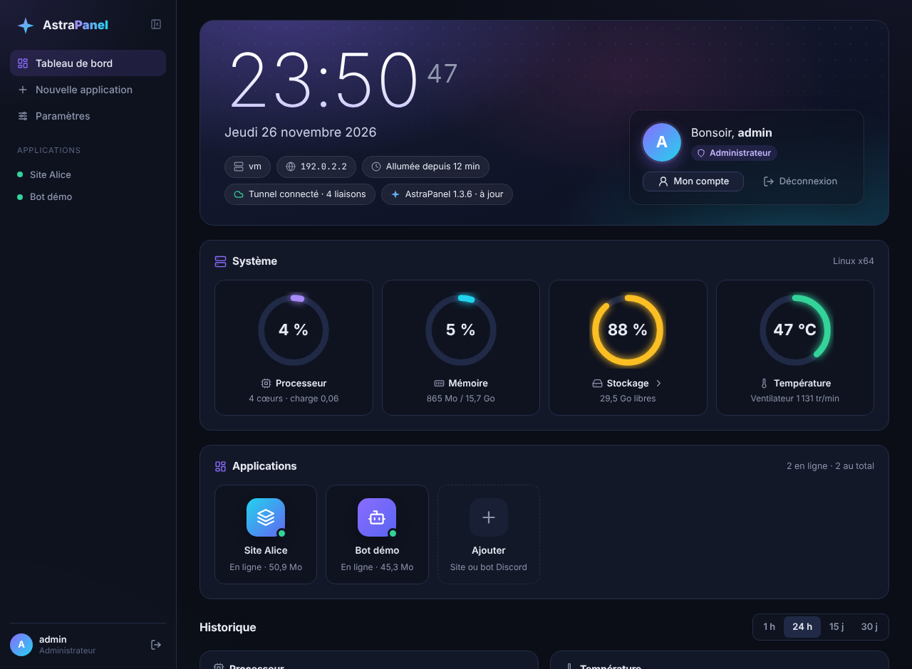
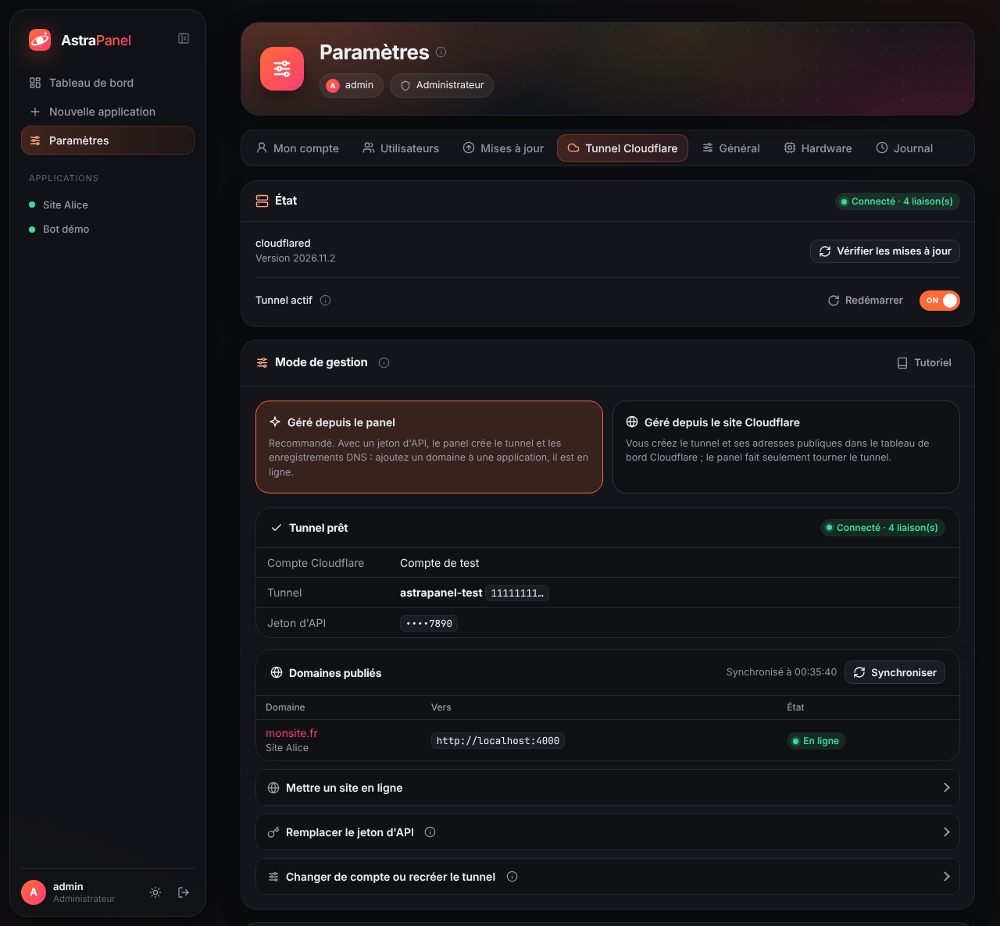

# AstraPanel

**Un panel web auto-hébergé pour faire tourner vos sites et vos bots Discord en JavaScript sur votre propre machine
Linux : ordinateur, mini-PC, serveur à la maison, VPS…**

Créez une application en quelques clics, déposez-y votre code (fichiers, dépôt Git ou archive ZIP), suivez ses logs en direct,
gérez ses fichiers, ses variables d'environnement, et mettez vos sites en ligne en HTTPS avec votre nom de domaine grâce
au tunnel Cloudflare intégré. Le panel se met à jour lui-même depuis GitHub.



<details><summary>Thème clair</summary>


</details>

## 👉 [Tutoriel complet : installer AstraPanel sur votre machine](docs/TUTORIEL.md)

## 👉 [Tutoriel Cloudflare : mettre vos sites en ligne avec votre nom de domaine](docs/CLOUDFLARE.md)

## Fonctionnalités

- **Bots Discord** (discord.js ou tout programme Node.js) avec redémarrage automatique en cas de plantage
- **Sites Node.js** (Express, Fastify, Next.js…) : le panel attribue un port à chaque site via `PORT`
- **Sites statiques** (HTML, ou le résultat d'un build Vite/React) avec mode SPA
- **Console en direct** des logs (stdout/stderr) et envoi de commandes sur l'entrée standard
- **Gestionnaire de fichiers** : double-clic pour ouvrir, menu clic droit (avec propriétés), sélection multiple,
  déplacer, copier, renommer, compresser en ZIP, extraire, téléverser des fichiers et des dossiers (glisser-déposer),
  télécharger un dossier en ZIP, éditeur de code avec numéros de ligne, visionneuse d'images, de vidéos et de sons
- **Variables d'environnement** (tableau ou collage d'un fichier `.env`) pour garder vos tokens hors du code
- **Déploiement** depuis Git en un clic (pull + `npm install` + build + redémarrage), import d'archive ZIP, webhook
  pour redéployer à chaque `git push`
- **Tunnel Cloudflare intégré** : mise en ligne en HTTPS sans ouvrir de port ; en mode « géré par le panel », ajouter
  un domaine à une application crée tout seul la route du tunnel et l'enregistrement DNS, avec un pas-à-pas en
  français dans le panel
- **Tutoriels intégrés** : les tutoriels (installation, tunnel Cloudflare) lisibles directement dans le panel, depuis
  les pages qui y renvoient (bouton « Tutoriel » du tunnel Cloudflare)
- **Tableau de bord façon bureau** : grande horloge et date, jauges du processeur, de la mémoire, du stockage et de
  la température, lanceur d'applications, et graphiques sur 1 h, 12 h, 24 h, 3 jours et 7 jours
- **Notifications** (cloche de la barre du haut) : application plantée, déploiement en échec, mise à jour disponible,
  tunnel déconnecté, sous-tension ou surchauffe ; à son arrivée, une notification s'affiche quelques secondes sous la
  cloche ; chacune s'efface d'une croix, ou toutes avec « Tout effacer »
- **Panneau latéral masquable** : il se cache sur la gauche pour laisser toute la place au contenu
- **Explorateur de stockage** : les disques de la machine et leur contenu trié par taille, pour trouver ce qui prend de la place
- **Mises à jour depuis le panel** : AstraPanel vérifie GitHub toutes les 5 minutes et annonce les nouvelles versions
  aux administrateurs par une notification ; un clic suffit pour mettre à jour, sans SSH. Pendant la mise à jour, le
  panel est flouté avec un écran de chargement qui suit chaque étape, puis le cache du navigateur est vidé et la page
  rechargée
- **Journal d'activité** : chaque action (connexions, applications, fichiers, comptes, tunnel, mises à jour,
  redémarrages) avec le compte, la date et l'adresse IP, filtrable par compte et par application — sans aucun secret
- **Onglet Hardware** : informations sur la machine et redémarrage de la machine depuis le panel, avec validation
- **Gestion de son compte** : pseudo, photo de profil (recadrée dans le navigateur), mot de passe avec jauge de force,
  déconnexion des autres appareils, dernières connexions, tentatives échouées et activité récente
- **Bureau façon système d'exploitation** : barre du haut (recherche Ctrl+K au centre, notifications, thème, heure,
  menu du compte), pages en plein écran sur un fond d'écran (seul le contenu défile), menu clic droit sur tout le site
- **Statistiques par application** : historique processeur et mémoire vive (1 h, 12 h, 24 h, 3 jours, 7 jours) en graphiques
- **Interface** : logo « planète en orbite », panneau latéral flottant, onglets en pastilles ;
  thème sombre et thème clair (automatique selon l'appareil, ou au choix) et cinq couleurs d'accent (Solaire par
  défaut, Océan, Aurore, Nébuleuse, Framboise), enregistrés avec chaque compte ; écran de connexion façon écran de
  verrouillage, avec l'heure
- **Grades ADMIN et UTILISATEUR** : chaque application a sa liste d'utilisateurs (onglet **Utilisateurs** : le
  créateur, figé, puis les comptes à qui il a donné accès) ; les administrateurs voient toutes les applications et
  gèrent aussi le panel
- **Création express** : un nom, un type (bot Discord, site Node.js ou site statique) et l'application est prête,
  avec un dossier vide où déposer votre code
- Applications relancées automatiquement au démarrage de la machine, interface utilisable sur mobile
- **Zéro dépendance npm** : le panel n'utilise que Node.js, rien à compiler

| Gestionnaire de fichiers | Tunnel Cloudflare |
| --- | --- |
|  |  |

## Installation rapide

Sur une machine **Linux 64 bits avec apt et systemd** (Debian, Ubuntu ou un dérivé), architecture x86-64 ou ARM64 :

```bash
sudo apt install -y git
```

La dernière version est toujours sur la branche `AstraPanel-Latest` :

```bash
git clone -b AstraPanel-Latest https://github.com/rizaky-myapps/AstraPanel.git
```

```bash
cd AstraPanel && sudo ./install.sh
```

Ouvrez ensuite `http://<ip-de-la-machine>:8080` et saisissez le jeton d'installation affiché à la fin du script.
Toutes les étapes, de la préparation de la machine jusqu'à la mise en ligne, sont dans le
[tutoriel](docs/TUTORIEL.md).

Le script installe Node.js 24 LTS (si besoin), git, zip, les outils de compilation (pour les modules natifs de vos
bots), crée l'utilisateur système `astrapanel`, copie le panel dans `/opt/astrapanel` et le lance comme service
systemd, avec le service de mise à jour `astrapanel-update`. Relancer le script ne touche pas à vos applications.

## Versions

- **`AstraPanel-Latest`** (branche principale) contient toujours la dernière version. Chaque version est aussi
  conservée sur sa propre branche **`AstraPanel-V.X.Y.Z`**, avec exactement les mêmes fichiers.
- Les versions avancent de 0.0.1 à chaque publication : 1.2.8 → 1.2.9 → 1.3.0 → 1.3.1.
- Les panels installés regardent `AstraPanel-Latest` toutes les 5 minutes et lisent la version dans son
  `package.json` : si elle est plus récente, une notification l'annonce aux administrateurs, et un clic dans
  **Paramètres → Mises à jour** l'installe.
- Pour publier une version : `./scripts/nouvelle-version.sh` (calcule la version suivante, met à jour
  `package.json`, pousse `AstraPanel-Latest` et crée `AstraPanel-V.X.Y.Z`).

## Fonctionnement

```
                Internet (HTTPS, votre nom de domaine)
                                │
                     ┌──────────▼──────────┐
                     │  Cloudflare (edge)  │
                     └──────────▲──────────┘
                                │ tunnel sortant (aucun port ouvert sur la box)
   ┌────────────────────────────┴────────────────────────────────────────┐
   │ Votre machine (Linux)                                                │
   │   AstraPanel :8080 ── supervise ──► cloudflared, site :4000,         │
   │   (interface + API)                  site :4001, bot Discord…        │
   │   astrapanel-update (root, sur demande) : installe AstraPanel-Latest │
   │   astrapanel-reboot (root, sur demande) : redémarre la machine       │
   └──────────────────────────────────────────────────────────────────────┘
```

- Chaque application est un processus lancé par le panel dans son propre groupe de processus (arrêt propre de tout
  l'arbre, `npm start` compris), avec redémarrage automatique et backoff en cas de plantage.
- Les sites reçoivent leur port dans `PORT`. Le tunnel Cloudflare, lancé en même temps que le panel, redirige chaque
  domaine vers le bon port.
- Le panel tourne sans privilèges. Pour se mettre à jour, il crée `data/update-request` : une unité systemd `.path`
  lance alors `astrapanel-update` en root, qui télécharge la branche `AstraPanel-Latest` et relance `install.sh`.
  Même principe pour redémarrer la machine (Paramètres → Hardware) : `data/reboot-request` → `astrapanel-reboot`.
- Les données sont dans `/opt/astrapanel/data` : `db.json` (configuration), `apps/<id>/` (fichiers des applis),
  `logs/` (journaux avec rotation), `metrics.json` (historique des graphiques), `bin/cloudflared`.

## Développement

Node.js 20 ou plus suffit, sans aucun `npm install` :

```bash
npm run dev
```

Le panel démarre sur `http://localhost:8080` avec ses données dans `./data` ; le jeton de première connexion
s'affiche dans le terminal. Variables utiles : `ASTRA_PORT` (ou `PORT`), `ASTRA_DATA_DIR`, `ASTRA_HOST`. Le panel peut donc aussi tourner comme
application d'un autre AstraPanel (pour tester une version) : il prend le port fourni dans `PORT` et garde ses données
dans son propre dossier `data/`.

```bash
npm test
```

```
src/
  server.js          serveur HTTP, routes, arrêt propre
  auth.js            comptes et grades (scrypt), sessions signées, limitation des tentatives
  domains.js         validation des noms de domaine
  tunnel.js          tunnel Cloudflare : cloudflared, API (tunnel, ingress, DNS)
  update.js          suivi de la branche AstraPanel-Latest, demande de mise à jour
  audit.js           journal d'activité (qui a fait quoi, quand)
  hardware.js        informations sur la machine, demande de redémarrage
  version.js         numéros de version (+0.0.1) et noms des branches
  metrics.js         historique CPU / température / RAM (1 h, 12 h, 24 h, 3 j, 7 j)
  storage.js         disques et analyse de l'espace occupé
  system.js          statistiques de la machine
  apps/manager.js    cycle de vie des applis : démarrage, plantages, déploiements
  apps/files.js      opérations sur les fichiers (confinées au dossier de l'app)
  apps/logs.js       journaux en mémoire + fichiers avec rotation
  routes/            API REST (/api/...) et webhook (/hooks/...)
public/              interface web (JavaScript natif, sans build)
runtime/             serveur de fichiers statiques utilisé par les sites statiques
templates/           modèles de départ (bot Discord, site Node.js, site statique)
deploy/              services systemd, scripts de mise à jour (update.sh) et de redémarrage (reboot.sh)
scripts/             publication d'une nouvelle version (nouvelle-version.sh)
install.sh           installation / mise à jour sur la machine
```

## Sécurité

- Le code du panel appartient à `root` et le service tourne sous l'utilisateur sans privilèges `astrapanel`,
  avec un service systemd durci (`ProtectSystem`, `NoNewPrivileges`).
- Mots de passe hachés avec scrypt, cookies `HttpOnly` + `SameSite=Strict`, protection CSRF, limitation des
  tentatives de connexion, jeton à usage unique pour créer le premier compte.
- Grades : seules les routes d'administration (paramètres, utilisateurs, stockage, mises à jour, tunnel, suppression
  d'applications) sont réservées aux administrateurs. L'accès à chaque application est vérifié côté serveur pour
  toutes ses routes : un utilisateur absent de sa liste reçoit « application introuvable ». Un utilisateur peut tout
  de même exécuter du code via ses applications : ne donnez de compte qu'à des personnes de confiance.
- Le gestionnaire de fichiers ne sort jamais du dossier de l'application et ne suit pas les liens symboliques qui
  pointent ailleurs ; les fichiers affichés en aperçu sont servis avec une politique CSP « sandbox ».
- Le service de mise à jour ne télécharge que le dépôt enregistré à l'installation (fichier appartenant à root) et
  installe toujours `AstraPanel-Latest`. Le service de redémarrage n'accepte qu'une demande du démarrage en cours.
- Journal d'activité : chaque action est enregistrée avec le compte et l'adresse IP, sans mot de passe, jeton ni
  valeur de variable.
- **Toutes les applications tournent sous le même utilisateur** : une application peut lire les fichiers des
  autres et la configuration du panel. N'hébergez que du code en lequel vous avez confiance.
- N'ouvrez jamais le port 8080 sur votre box : pour administrer à distance, utilisez le domaine du panel via le
  tunnel Cloudflare, ou un VPN.
