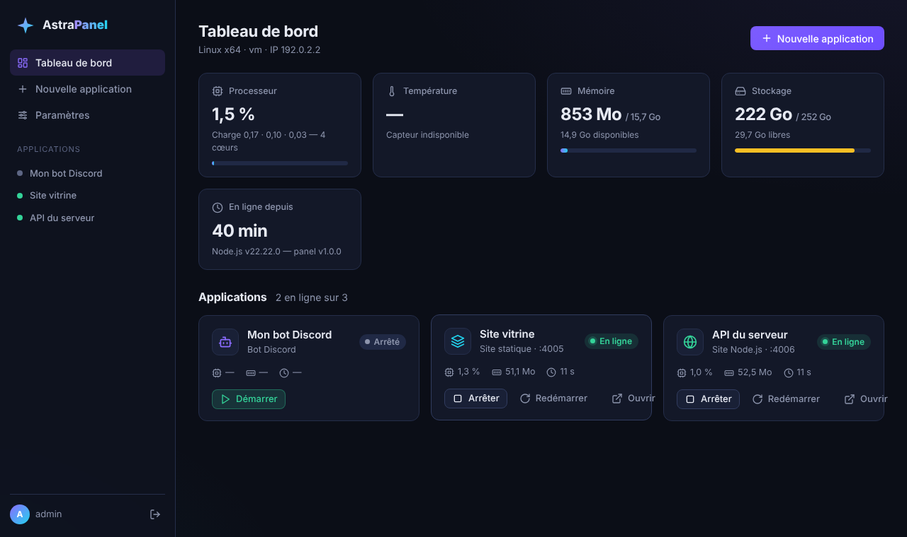
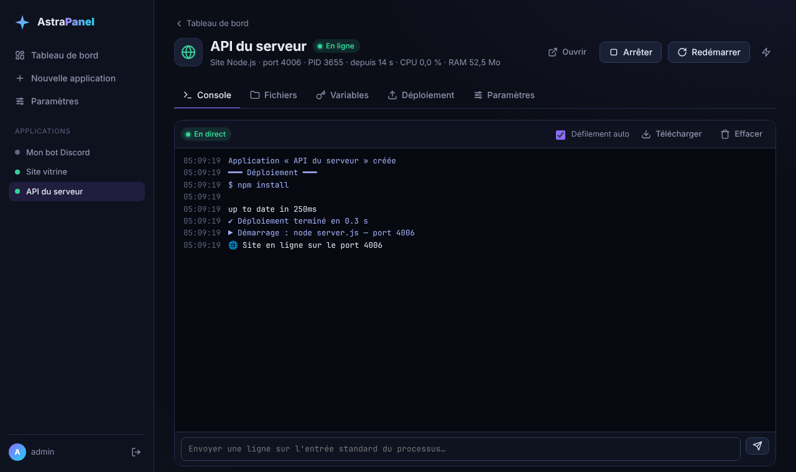
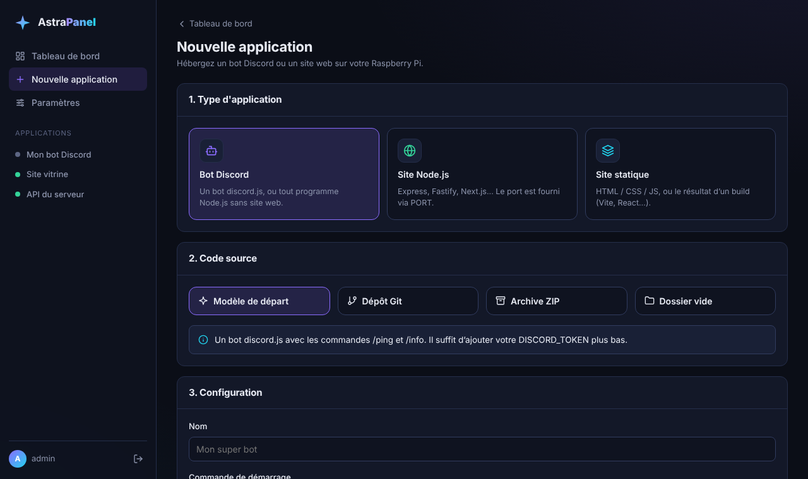

# AstraPanel

**Un panel web auto-hébergé pour faire tourner vos sites et vos bots Discord en JavaScript sur un Raspberry Pi 5.**

Créez une application en quelques clics (depuis un modèle, un dépôt Git ou une archive ZIP), suivez ses logs en direct,
modifiez ses fichiers, gérez ses variables d'environnement et mettez vos sites en ligne en HTTPS avec votre nom de domaine.



## 👉 [Tutoriel complet : installer AstraPanel sur un Raspberry Pi 5](docs/TUTORIEL.md)

## Fonctionnalités

- **Bots Discord** (discord.js ou tout programme Node.js) avec redémarrage automatique en cas de plantage
- **Sites Node.js** (Express, Fastify, Next.js…) : le panel attribue un port à chaque site via `PORT`
- **Sites statiques** (HTML, ou le résultat d'un build Vite/React) avec mode SPA
- **Console en direct** des logs (stdout/stderr) et envoi de commandes sur l'entrée standard
- **Gestionnaire de fichiers** avec éditeur de code, téléversement par glisser-déposer et téléchargement
- **Variables d'environnement** (tableau ou collage d'un fichier `.env`) pour garder vos tokens hors du code
- **Déploiement** depuis Git en un clic (pull + `npm install` + build + redémarrage), import d'archive ZIP
- **Webhook** pour redéployer automatiquement à chaque `git push` (GitHub, GitLab, Gitea…)
- **Noms de domaine et HTTPS automatique** grâce à [Caddy](https://caddyserver.com) (certificats Let's Encrypt)
- **Suivi du Raspberry Pi** : CPU, température, ventilateur, RAM, disque, alerte de sous-tension
- **Modèles de départ** : bot discord.js avec commandes slash, site Node.js, site statique
- Applications relancées automatiquement au démarrage du Pi
- Plusieurs comptes utilisateurs, sessions sécurisées, interface utilisable sur mobile
- **Zéro dépendance npm** : le panel n'utilise que Node.js, rien à compiler sur le Pi

| Console en direct | Création d'une application |
| --- | --- |
|  |  |

## Installation rapide

Sur un Raspberry Pi 5 sous **Raspberry Pi OS 64 bits** (Lite ou Desktop) :

```bash
sudo apt install -y git
```

```bash
git clone https://github.com/rizaky-myapps/AstraPanel.git
```

```bash
cd AstraPanel && sudo ./install.sh --with-caddy
```

Ouvrez ensuite `http://astrapanel.local:8080` (ou `http://<ip-du-pi>:8080`) et saisissez le jeton d'installation
affiché à la fin du script. Toutes les étapes, de la carte SD jusqu'à la mise en ligne, sont dans le
[tutoriel](docs/TUTORIEL.md).

Le script installe Node.js 24 LTS (si besoin), git, les outils de compilation (pour les modules natifs de vos bots),
crée l'utilisateur système `astrapanel`, copie le panel dans `/opt/astrapanel` et le lance comme service systemd.
`--with-caddy` installe et configure aussi Caddy pour les noms de domaine. Relancer le script met le panel à jour
sans toucher à vos applications.

## Fonctionnement

```
                    Internet
                        │  ports 80 / 443
              ┌─────────▼──────────┐
              │       Caddy        │  HTTPS automatique, un bloc par domaine
              └──┬──────────┬──────┘  (/etc/caddy/astrapanel/sites.caddy)
                 │          │
   ┌─────────────▼───┐  ┌───▼───────────────────────────────────────┐
   │ AstraPanel :8080│  │ Vos applications (utilisateur astrapanel) │
   │  interface web  ├──►  site Node.js  :4000                      │
   │  + superviseur  │  │  site statique :4001                      │
   └─────────────────┘  │  bot Discord   (pas de port)              │
                        └───────────────────────────────────────────┘
```

- Chaque application est un processus lancé par le panel dans son propre groupe de processus (arrêt propre de tout
  l'arbre, `npm start` compris), avec redémarrage automatique et backoff en cas de plantage.
- Les sites reçoivent leur port dans `PORT` ; Caddy redirige chaque domaine vers le bon port.
- Les données sont dans `/opt/astrapanel/data` : `db.json` (configuration), `apps/<id>/` (fichiers des applis),
  `logs/` (journaux avec rotation).

## Développement

Node.js 20 ou plus suffit, sans aucun `npm install` :

```bash
npm run dev
```

Le panel démarre sur `http://localhost:8080` avec ses données dans `./data` ; le jeton de première connexion
s'affiche dans le terminal. Variables utiles : `ASTRA_PORT`, `ASTRA_DATA_DIR`, `ASTRA_HOST`, `ASTRA_CADDY_DIR`.

```bash
npm test
```

```
src/
  server.js          serveur HTTP, routes, arrêt propre
  auth.js            comptes (scrypt), sessions signées, limitation des tentatives
  caddy.js           génération de la configuration Caddy et rechargement
  system.js          statistiques du Raspberry Pi
  apps/manager.js    cycle de vie des applis : démarrage, plantages, déploiements
  apps/files.js      gestionnaire de fichiers (confiné au dossier de l'app)
  apps/logs.js       journaux en mémoire + fichiers avec rotation
  routes/            API REST (/api/...) et webhook (/hooks/...)
public/              interface web (JavaScript natif, sans build)
runtime/             serveur de fichiers statiques utilisé par les sites statiques
templates/           modèles de départ (bot Discord, site Node.js, site statique)
deploy/              service systemd
install.sh           installation / mise à jour sur le Pi
```

## Sécurité

- Le code du panel appartient à `root` et le service tourne sous l'utilisateur sans privilèges `astrapanel`,
  avec un service systemd durci (`ProtectSystem`, `NoNewPrivileges`).
- Mots de passe hachés avec scrypt, cookies `HttpOnly` + `SameSite=Strict`, protection CSRF, limitation des
  tentatives de connexion, jeton à usage unique pour créer le premier compte.
- **Toutes les applications tournent sous le même utilisateur** : une application peut lire les fichiers des
  autres et la configuration du panel. N'hébergez que du code en lequel vous avez confiance.
- N'ouvrez jamais le port 8080 sur votre box : pour administrer à distance, utilisez le domaine du panel (HTTPS via
  Caddy), un tunnel Cloudflare ou un VPN.
