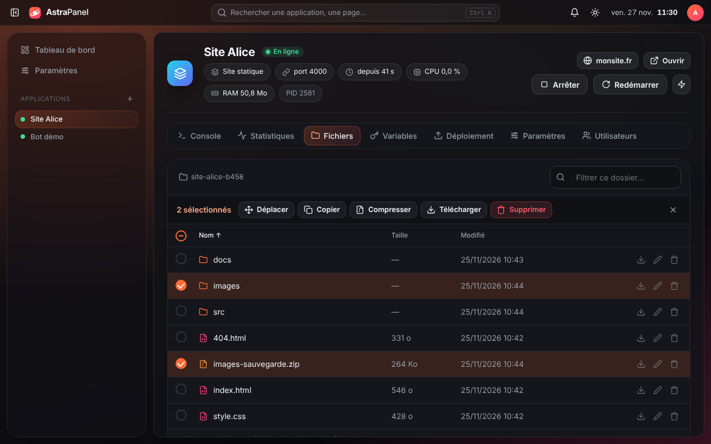

# AstraPanel

**Un panel web auto-hébergé pour faire tourner vos sites et vos bots Discord en JavaScript sur un Raspberry Pi 5.**

Créez une application en quelques clics (depuis un modèle, un dépôt Git ou une archive ZIP), suivez ses logs en direct,
gérez ses fichiers, ses variables d'environnement, et mettez vos sites en ligne en HTTPS avec votre nom de domaine grâce
au tunnel Cloudflare intégré. Le panel se met à jour lui-même depuis GitHub.


## 👉 [Tutoriel complet : installer AstraPanel sur un Raspberry Pi 5](docs/TUTORIEL.md)

## Fonctionnalités

- **Bots Discord** (discord.js ou tout programme Node.js) avec redémarrage automatique en cas de plantage
- **Sites Node.js** (Express, Fastify, Next.js…) : le panel attribue un port à chaque site via `PORT`
- **Sites statiques** (HTML, ou le résultat d'un build Vite/React) avec mode SPA
- **Console en direct** des logs (stdout/stderr) et envoi de commandes sur l'entrée standard
- **Gestionnaire de fichiers** : sélection multiple, déplacer, copier, renommer, compresser en ZIP, extraire,
  téléverser des fichiers et des dossiers (glisser-déposer), télécharger un dossier en ZIP, éditeur de code avec
  numéros de ligne, visionneuse d'images, de vidéos et de sons
- **Variables d'environnement** (tableau ou collage d'un fichier `.env`) pour garder vos tokens hors du code
- **Déploiement** depuis Git en un clic (pull + `npm install` + build + redémarrage), import d'archive ZIP, webhook
  pour redéployer à chaque `git push`
- **Tunnel Cloudflare intégré** : mise en ligne en HTTPS sans ouvrir de port ; en mode « géré par le panel », ajouter
  un domaine à une application crée tout seul la route du tunnel et l'enregistrement DNS
- **Caddy** en option, pour publier les sites via votre propre IP publique (HTTPS Let's Encrypt)
- **Tableau de bord** : graphiques du processeur, de la température et de la RAM sur 1 h, 24 h, 15 jours et 30 jours,
  alerte de sous-tension du Pi
- **Explorateur de stockage** : les disques du Pi et leur contenu trié par taille, pour trouver ce qui prend de la place
- **Mises à jour depuis le panel** : AstraPanel détecte les nouvelles versions sur GitHub et prévient les
  administrateurs ; un clic suffit pour mettre à jour, sans SSH
- **Grades ADMIN et UTILISATEUR** : les utilisateurs gèrent les applications, les administrateurs gèrent aussi le panel
- **Modèles de départ** : bot discord.js (commandes `/ping` et `/text`), site Node.js, site statique
- Applications relancées automatiquement au démarrage du Pi, interface utilisable sur mobile
- **Zéro dépendance npm** : le panel n'utilise que Node.js, rien à compiler sur le Pi

| Gestionnaire de fichiers | Tunnel Cloudflare |
| --- | --- |
|  |  |

## Installation rapide

Sur un Raspberry Pi 5 sous **Raspberry Pi OS 64 bits** (Lite ou Desktop) :

```bash
sudo apt install -y git
```

```bash
git clone https://github.com/rizaky-myapps/AstraPanel.git
```

```bash
cd AstraPanel && sudo ./install.sh
```

Ouvrez ensuite `http://astrapanel.local:8080` (ou `http://<ip-du-pi>:8080`) et saisissez le jeton d'installation
affiché à la fin du script. Toutes les étapes, de la carte SD jusqu'à la mise en ligne, sont dans le
[tutoriel](docs/TUTORIEL.md).

Le script installe Node.js 24 LTS (si besoin), git, zip, les outils de compilation (pour les modules natifs de vos
bots), crée l'utilisateur système `astrapanel`, copie le panel dans `/opt/astrapanel` et le lance comme service
systemd, avec le service de mise à jour `astrapanel-update`. Ajoutez `--with-caddy` seulement si vous publiez vos sites
via votre propre IP publique (ports 80/443 ouverts) ; avec le tunnel Cloudflare, Caddy est inutile. Relancer le script
ne touche pas à vos applications.

## Fonctionnement

```
          Internet                                     Internet
             │ HTTPS                                      │ ports 80 / 443
   ┌─────────▼─────────┐                        ┌─────────▼─────────┐
   │ Cloudflare (edge) │◄── tunnel sortant ──┐  │  Caddy (option)   │
   └───────────────────┘                     │  └─────────┬─────────┘
                                             │            │
   ┌─────────────────────────────────────────┴────────────▼──────────────┐
   │ Raspberry Pi                                                        │
   │   AstraPanel :8080 ── supervise ──► cloudflared, site :4000,        │
   │   (interface + API)                  site :4001, bot Discord…       │
   │   astrapanel-update (root, à la demande) : mise à jour depuis GitHub │
   └─────────────────────────────────────────────────────────────────────┘
```

- Chaque application est un processus lancé par le panel dans son propre groupe de processus (arrêt propre de tout
  l'arbre, `npm start` compris), avec redémarrage automatique et backoff en cas de plantage.
- Les sites reçoivent leur port dans `PORT`. Le tunnel Cloudflare (ou Caddy) redirige chaque domaine vers le bon port.
- Le panel tourne sans privilèges. Pour se mettre à jour, il crée `data/update-request` : une unité systemd `.path`
  lance alors `astrapanel-update` en root, qui télécharge la branche suivie et relance `install.sh`.
- Les données sont dans `/opt/astrapanel/data` : `db.json` (configuration), `apps/<id>/` (fichiers des applis),
  `logs/` (journaux avec rotation), `metrics.json` (historique des graphiques), `bin/cloudflared`.

## Développement

Node.js 20 ou plus suffit, sans aucun `npm install` :

```bash
npm run dev
```

Le panel démarre sur `http://localhost:8080` avec ses données dans `./data` ; le jeton de première connexion
s'affiche dans le terminal. Variables utiles : `ASTRA_PORT`, `ASTRA_DATA_DIR`, `ASTRA_HOST`, `ASTRA_CADDY_DIR`.

```bash
npm test
```

```
src/
  server.js          serveur HTTP, routes, arrêt propre
  auth.js            comptes et grades (scrypt), sessions signées, limitation des tentatives
  caddy.js           génération de la configuration Caddy et rechargement
  tunnel.js          tunnel Cloudflare : cloudflared, API (tunnel, ingress, DNS)
  update.js          détection des nouvelles versions sur GitHub, demande de mise à jour
  metrics.js         historique CPU / température / RAM (1 h, 24 h, 15 j, 30 j)
  storage.js         disques et analyse de l'espace occupé
  system.js          statistiques du Raspberry Pi
  apps/manager.js    cycle de vie des applis : démarrage, plantages, déploiements
  apps/files.js      opérations sur les fichiers (confinées au dossier de l'app)
  apps/logs.js       journaux en mémoire + fichiers avec rotation
  routes/            API REST (/api/...) et webhook (/hooks/...)
public/              interface web (JavaScript natif, sans build)
runtime/             serveur de fichiers statiques utilisé par les sites statiques
templates/           modèles de départ (bot Discord, site Node.js, site statique)
deploy/              services systemd et script de mise à jour (update.sh)
install.sh           installation / mise à jour sur le Pi
```

## Sécurité

- Le code du panel appartient à `root` et le service tourne sous l'utilisateur sans privilèges `astrapanel`,
  avec un service systemd durci (`ProtectSystem`, `NoNewPrivileges`).
- Mots de passe hachés avec scrypt, cookies `HttpOnly` + `SameSite=Strict`, protection CSRF, limitation des
  tentatives de connexion, jeton à usage unique pour créer le premier compte.
- Grades : seules les routes d'administration (paramètres, utilisateurs, stockage, mises à jour, tunnel, suppression
  d'applications) sont réservées aux administrateurs. Un utilisateur peut tout de même exécuter du code via ses
  applications : ne donnez de compte qu'à des personnes de confiance.
- Le gestionnaire de fichiers ne sort jamais du dossier de l'application et ne suit pas les liens symboliques qui
  pointent ailleurs ; les fichiers affichés en aperçu sont servis avec une politique CSP « sandbox ».
- Le service de mise à jour ne télécharge que le dépôt enregistré à l'installation (fichier appartenant à root) ;
  la demande du panel ne peut choisir que la branche.
- **Toutes les applications tournent sous le même utilisateur** : une application peut lire les fichiers des
  autres et la configuration du panel. N'hébergez que du code en lequel vous avez confiance.
- N'ouvrez jamais le port 8080 sur votre box : pour administrer à distance, utilisez le domaine du panel (HTTPS via
  Caddy), un tunnel Cloudflare ou un VPN.
