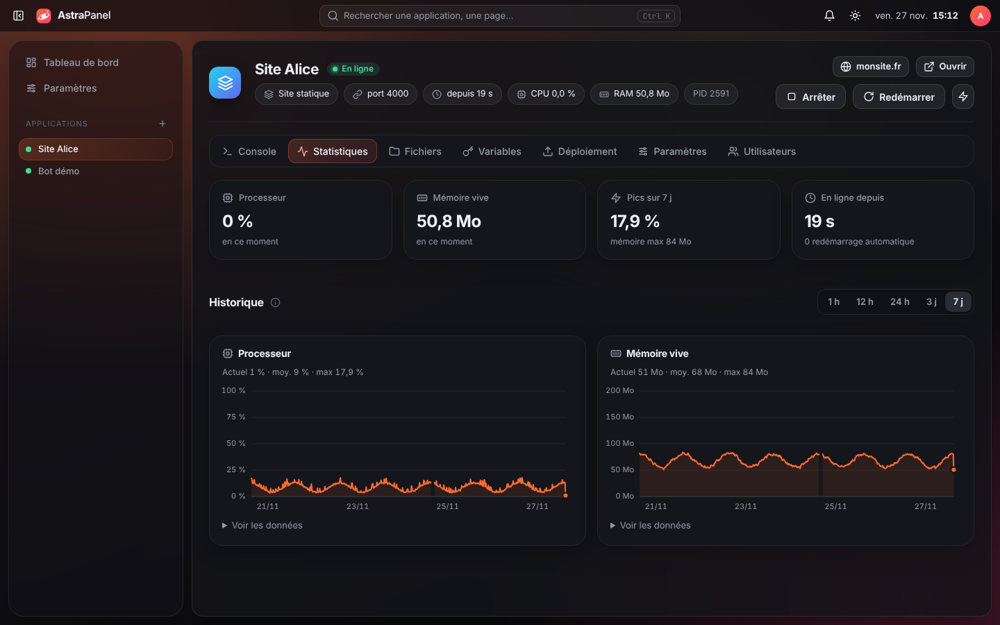
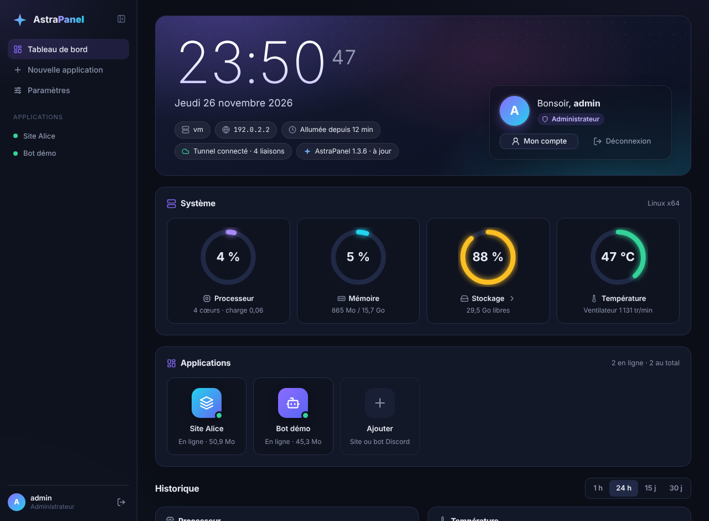
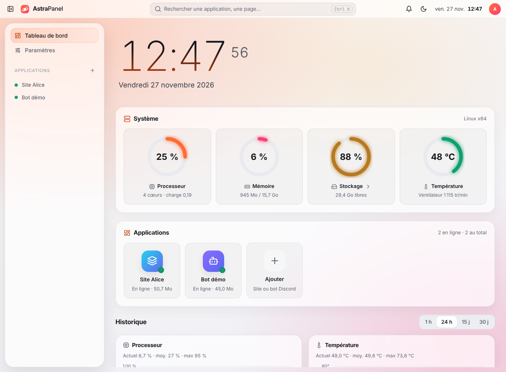

# Tutoriel : héberger vos sites, bots Discord et serveurs Minecraft sur votre propre machine avec AstraPanel

Ce guide part de zéro : vous préparez une machine Linux, installez AstraPanel, lancez votre premier bot Discord et
votre premier site, puis mettez le tout en ligne avec votre nom de domaine en HTTPS. Comptez environ une heure.

AstraPanel fonctionne sur **n'importe quelle machine Linux** : ancien ordinateur, mini-PC, serveur à la maison, carte
ARM ou serveur loué (VPS) chez un hébergeur.

## Sommaire

1. [Ce dont vous avez besoin](#1-ce-dont-vous-avez-besoin)
2. [Préparer la machine](#2-préparer-la-machine)
3. [Se connecter en SSH](#3-se-connecter-en-ssh)
4. [Donner une adresse IP fixe à la machine](#4-donner-une-adresse-ip-fixe-à-la-machine)
5. [Installer AstraPanel](#5-installer-astrapanel)
6. [Première connexion et tableau de bord](#6-première-connexion-et-tableau-de-bord)
7. [Héberger un bot Discord](#7-héberger-un-bot-discord)
8. [Héberger un site web](#8-héberger-un-site-web)
9. [Héberger un serveur Minecraft](#9-héberger-un-serveur-minecraft)
10. [Gérer les fichiers d'une application](#10-gérer-les-fichiers-dune-application)
11. [Mettre vos sites en ligne sur Internet](#11-mettre-vos-sites-en-ligne-sur-internet)
12. [Déploiement automatique depuis GitHub](#12-déploiement-automatique-depuis-github)
13. [Utilisateurs et grades](#13-utilisateurs-et-grades)
14. [Sécuriser la machine](#14-sécuriser-la-machine)
15. [Entretien : mises à jour, sauvegardes, journaux](#15-entretien--mises-à-jour-sauvegardes-journaux)
16. [Dépannage](#16-dépannage)

---

## 1. Ce dont vous avez besoin

| Élément | Recommandation |
| --- | --- |
| Une machine | Ordinateur, mini-PC, serveur, carte ARM 64 bits ou VPS. Processeur **x86-64 ou ARM 64 bits**. |
| Système | Une distribution Linux avec **apt** et **systemd** : **Debian 12+**, **Ubuntu 22.04+** ou une dérivée (Linux Mint, Armbian…). Une version serveur, sans bureau, laisse plus de mémoire à vos applications. |
| Mémoire | 2 Go de RAM pour quelques bots, 4 Go pour plusieurs bots et sites, davantage si vous hébergez beaucoup de sites. Un serveur Minecraft demande à lui seul 2 à 4 Go. |
| Stockage | 16 Go libres minimum ; un **SSD** est plus rapide et plus fiable pour une machine allumée en permanence. |
| Réseau | Un câble Ethernet relié à votre box (plus stable que le Wi-Fi), ou la connexion de votre VPS. |
| Un ordinateur | Pour vous connecter à la machine en SSH et utiliser le panel depuis votre navigateur. |

Pour la mise en ligne (étape 11), il vous faudra aussi un **nom de domaine** (une dizaine d'euros par an chez
OVHcloud, Gandi, Infomaniak, Cloudflare…). Les sous-domaines gratuits de type DuckDNS ne conviennent pas.

## 2. Préparer la machine

**Machine à la maison.** Installez **Debian** ([debian.org](https://www.debian.org/)) ou **Ubuntu Server**
([ubuntu.com/download/server](https://ubuntu.com/download/server)) depuis une clé USB d'installation. Pendant
l'installation :

- **Nom de la machine** : par exemple `astrapanel` ;
- **Compte utilisateur** : un nom (par exemple `admin`) et un mot de passe solide ; ce compte doit pouvoir utiliser
  `sudo` ;
- **Logiciels** : cochez **serveur SSH** (« OpenSSH server » sous Ubuntu) ; l'environnement de bureau est facultatif.

Si la machine a déjà un système Linux compatible (voir le tableau ci-dessus), gardez-le : il suffit que SSH soit
activé. Pour une carte ARM, utilisez l'image officielle 64 bits de son fabricant.

**Serveur loué (VPS).** Choisissez **Debian 12** ou **Ubuntu 24.04** à la commande : l'hébergeur vous donne
l'adresse IP du serveur et un accès SSH.

Laissez la machine branchée sur le réseau et allumée : elle hébergera vos sites et vos bots 24 h/24.

## 3. Se connecter en SSH

Depuis votre ordinateur, ouvrez un terminal (sous Windows : **Terminal** ou **PowerShell**, la commande `ssh` est
incluse) :

```bash
ssh admin@192.168.1.50
```

Remplacez `admin` par votre nom d'utilisateur et `192.168.1.50` par l'adresse IP de la machine. Acceptez l'empreinte
de sécurité (`yes`) puis tapez votre mot de passe.

> L'adresse IP d'une machine à la maison se trouve dans l'interface de votre box (liste des appareils connectés), ou
> sur la machine elle-même avec la commande `hostname -I`.

Dans la suite du guide, **`<ip-de-la-machine>`** désigne cette adresse.

Mettez le système à jour puis redémarrez :

```bash
sudo apt update && sudo apt full-upgrade -y
```

```bash
sudo reboot
```

Attendez une minute et reconnectez-vous en SSH.

## 4. Donner une adresse IP fixe à la machine

Une machine à la maison doit toujours recevoir la même adresse de votre box : vous retrouverez ainsi toujours le
panel et vos sites à la même adresse sur votre réseau local, et la connexion SSH ne changera pas. *(Sur un VPS,
l'adresse est déjà fixe : passez à l'étape 5.)*

**Méthode conseillée : un bail DHCP statique dans votre box.** Dans l'interface de votre box (Freebox, Livebox,
Bbox, Box SFR…), cherchez la rubrique **DHCP** puis **baux statiques** (ou « attribution d'adresse IP fixe ») et
associez une adresse à la machine (repérable par son nom, par exemple `astrapanel`).

**Autre méthode : configurer l'IP sur la machine.** Si votre système utilise NetworkManager (c'est le cas d'Ubuntu
avec bureau et de beaucoup de distributions), repérez le nom de la connexion :

```bash
nmcli connection show
```

Puis adaptez cette commande (nom de la connexion, adresse voulue, adresse de la box) :

```bash
sudo nmcli connection modify "Wired connection 1" ipv4.method manual ipv4.addresses 192.168.1.50/24 ipv4.gateway 192.168.1.1 ipv4.dns "1.1.1.1 9.9.9.9"
```

```bash
sudo nmcli connection up "Wired connection 1"
```

Sans NetworkManager, la configuration se fait dans `/etc/network/interfaces` (Debian) ou dans `/etc/netplan/`
(Ubuntu Server) : le bail statique dans la box reste le plus simple.

Choisissez une adresse hors de la plage distribuée automatiquement par votre box. Votre session SSH sera coupée :
reconnectez-vous avec la nouvelle adresse.

## 5. Installer AstraPanel

Toujours en SSH sur la machine :

```bash
sudo apt install -y git
```

La dernière version d'AstraPanel se trouve toujours sur la branche `AstraPanel-Latest` (chaque version est aussi gardée
sur sa propre branche `AstraPanel-V.X.Y.Z`). Téléchargez-la :

```bash
git clone -b AstraPanel-Latest https://github.com/rizaky-myapps/AstraPanel.git
```

```bash
cd AstraPanel
```

```bash
sudo ./install.sh
```

> **Dépôt privé ?** Si le dépôt GitHub est privé, `git clone` demandera un identifiant : utilisez votre nom
> d'utilisateur GitHub et, comme mot de passe, un *personal access token* (GitHub → Settings → Developer settings
> → Personal access tokens).

Le script, qui prend quelques minutes :

- installe git, zip/unzip et les outils de compilation (nécessaires à certains modules npm de bots, comme ceux pour la voix) ;
- installe **Node.js 24 LTS** si aucune version récente n'est présente ;
- crée l'utilisateur système `astrapanel`, qui fera tourner le panel et vos applications sans droits administrateur ;
- copie le panel dans `/opt/astrapanel` et crée le service `astrapanel` qui démarre avec la machine ;
- installe le petit service `astrapanel-update`, qui permettra de **mettre le panel à jour depuis son interface**
  (plus besoin de SSH, voir l'étape 15).

À la fin, le script affiche l'adresse du panel et un **jeton d'installation** :

```
✔ AstraPanel est installé et démarré !

  Adresse du panel : http://192.168.1.50:8080

  Jeton d'installation (à saisir à la première connexion) : Xy3k9QpL2mWa
```

> Si la machine annonce son nom sur le réseau (service avahi), une deuxième adresse en `.local` s'affiche aussi,
> par exemple `http://astrapanel.local:8080`.
>
> Option du script : `--port=9000` change le port du panel (8080 par défaut).
> Vous pouvez relancer le script à tout moment : vos applications sont conservées.

## 6. Première connexion et tableau de bord

1. Sur votre ordinateur (ou votre téléphone, connecté au même réseau), ouvrez **http://<ip-de-la-machine>:8080** (l'adresse affichée par le script).
   Chaque page du panel a sa propre adresse, sans `#` : `/home` pour le tableau de bord, `/apps/<application>/console`,
   `/settings/compte`… Vous pouvez les mettre en favori ; les boutons Précédent et Suivant du navigateur fonctionnent.
2. Saisissez le **jeton d'installation**. Si vous l'avez perdu, affichez-le sur la machine :

   ```bash
   sudo cat /opt/astrapanel/data/setup-token
   ```

3. Choisissez votre nom d'utilisateur et un mot de passe solide (8 caractères minimum). Ce premier compte est
   **administrateur** (voir l'étape 13 pour ajouter d'autres personnes).

L'écran de connexion affiche l'heure et la date, comme l'écran de verrouillage d'un téléphone. Une fois connecté, le
panel se présente comme le **bureau d'un système d'exploitation** :

- la **barre du haut**, toujours visible :
  - tout à gauche, le bouton du **panneau latéral** : il le **cache sur la gauche** pour laisser toute la place au
    contenu, puis le fait revenir (sur téléphone, il ouvre le menu) ;
  - le logo, qui ramène au bureau ;
  - au centre, **Rechercher** (ou **Ctrl + K**) : tapez quelques lettres pour ouvrir une application, une page des
    paramètres, un tutoriel, ou changer de thème ; flèches puis **Entrée** pour choisir ;
  - la **cloche** : les notifications (application plantée, déploiement en échec, mise à jour disponible, tunnel
    Cloudflare déconnecté, sous-tension ou processeur bridé par la chaleur) ; un clic ouvre la page concernée, la
    **croix** d'une notification l'efface et **Tout effacer** les efface toutes. Une notification effacée ne revient
    que si la situation se reproduit (nouveau plantage, nouvelle version, nouvelle sous-tension…). Quand une
    notification arrive, la cloche sonne et la notification s'affiche **environ 5 secondes sous la cloche** (la souris
    posée dessus la garde affichée ; un clic ouvre la page concernée) ;
  - le bouton **soleil / lune** (thème clair ou sombre), la date et l'heure, et votre **photo** : menu du compte
    (**Mon compte**, thème **Automatique / Clair / Sombre**, aide, **Se déconnecter**) ;
- chaque page s'ouvre en **plein écran** dans une fenêtre posée sur le fond d'écran : la page elle-même ne défile
  jamais, seul le contenu de la fenêtre défile quand il est long (la console, elle, remplit exactement la fenêtre) ;
- le **clic droit** ouvre le menu du panel : sur une application (panneau latéral ou bureau) pour l'ouvrir, aller
  à sa console, ses statistiques, ses fichiers, la démarrer, l'arrêter ou la redémarrer, et, si elle a un domaine,
  **Ouvrir <domaine>** (un site, dans un nouvel onglet) ou **Copier l'IP** (un serveur de jeux : copie son adresse
  de connexion) ; ailleurs pour rechercher,
  créer une application, actualiser, changer de thème ou masquer le panneau latéral. Dans les champs de saisie, et
  avec **Maj + clic droit**, c'est le menu habituel du navigateur ;
- le panel a un **thème sombre et un thème clair** : par défaut (et pour tout nouveau compte) il est en
  **automatique** et suit le réglage de votre appareil ; **Mon compte → Apparence** (menu du compte, en haut à droite) permet aussi de
  choisir la couleur du panel et du fond d'écran (voir l'étape 13).

Le **tableau de bord** (adresse `/home`) est le bureau lui-même, sans fenêtre : ses widgets sont posés sur le fond
d'écran :

- en haut, l'**horloge** et la **date**, en grand ;
- quatre **jauges** en direct : processeur, mémoire, stockage et température (avec la vitesse du ventilateur quand la
  machine la fournit). Sous chacune, une **mini-courbe** montre les 30 dernières minutes (une barre pour le
  stockage). Une jauge passe à l'orange puis au rouge quand la valeur devient élevée. Une sous-tension (alimentation
  insuffisante) ou un processeur bridé par la chaleur sont signalés par une notification (cloche de la barre du haut) ;
- le bloc **Applications** : une carte par application, avec son état (en ligne, arrêtée, plantée…), son domaine ou
  son port, et sa charge **processeur** et **mémoire** en direct ; un clic l'ouvre. La carte **Nouvelle
  application** en crée une ;
- le bloc **Machine** : son nom, son système, depuis quand elle est allumée, son adresse IP et les versions de Node.js
  et d'AstraPanel ;
- en dessous, les **graphiques** du processeur, de la température et de la mémoire, avec le choix de la période :
  **1 h, 12 h, 24 h, 3 j ou 7 j**. Survolez une courbe pour lire la valeur à un instant donné. L'historique se
  remplit au fil du temps (il est conservé 7 jours) ;
- un clic sur la jauge **Stockage** (administrateurs) ouvre l'explorateur de stockage : la liste des disques de la
  machine (disque interne, SSD, clé USB…) et, pour chacun, les dossiers et fichiers **triés du plus lourd au plus
  léger**. Cliquez sur un dossier pour descendre dedans et trouver ce qui prend de la place (les `node_modules`, les
  journaux, une vieille archive…).

Vos applications sont aussi listées dans le **panneau latéral**, sous **Tableau de bord** et **Paramètres**, rangées par
catégorie : **Bots**, **Sites** (Node.js et statiques) et **Serveurs** (Minecraft). Pour changer l'ordre, **glissez** une
application à la place voulue dans sa catégorie (sur téléphone : **appui long**, puis glissez ; au clavier : **Alt + ↑ / ↓**
sur l'application sélectionnée ; **Échap** pendant le glissement annule). Les tuiles du tableau de bord suivent le même
ordre et se déplacent de la même façon. L'ordre est enregistré avec votre compte : chacun range ses applications comme il
veut, sur tous ses appareils. Le petit
**+** à côté du mot **Applications** en crée une nouvelle (comme la tuile **Ajouter** du tableau de bord). Chaque application a
ses onglets (Console, Statistiques, Fichiers, Variables, Déploiement, Paramètres, Utilisateurs) ; quand vous passez
d'une application à l'autre, le panel garde l'onglet ouvert (par exemple **Fichiers**) au lieu de revenir à la console.

L'onglet **Statistiques** d'une application montre sa charge **processeur** et sa **mémoire vive** : valeurs actuelles,
pics de la période, durée depuis le démarrage, puis deux **graphiques** sur **1 h, 12 h, 24 h, 3 j ou 7 j** (survolez une
courbe pour lire une valeur). Les mesures (tous les processus de
l'application, toutes les 10 secondes) sont enregistrées pendant qu'elle tourne et gardées 7 jours ; un arrêt laisse un
vide dans les courbes. 100 % correspond à un cœur de processeur entièrement occupé.







## 7. Héberger un bot Discord

### 7.1 Créer le bot sur Discord

1. Allez sur le [portail développeur Discord](https://discord.com/developers/applications) et cliquez sur
   **New Application**. Donnez-lui un nom.
2. Dans l'onglet **Bot**, cliquez sur **Reset Token** et copiez le token affiché.
   **Ce token est un mot de passe** : ne le publiez jamais (ni sur GitHub, ni sur Discord).
3. Si votre bot lit le contenu des messages, activez **Message Content Intent** dans ce même onglet (un bot qui
   n'utilise que des commandes slash n'a besoin d'aucun *intent* privilégié).
4. Invitez le bot sur votre serveur : onglet **OAuth2** → **URL Generator**, cochez les scopes **bot** et
   **applications.commands**, puis les permissions utiles (au minimum *View Channels* et *Send Messages*). Ouvrez l'URL générée et
   choisissez votre serveur.

### 7.2 Créer l'application

1. Dans AstraPanel, cliquez sur le **+** à côté de **Applications** dans le panneau latéral (ou sur la tuile **Ajouter**
   du tableau de bord) : la page **Nouvelle application** s'ouvre.
2. Tout en haut, donnez-lui un **nom**, puis choisissez **Bot Discord** dans le menu **Type d'application**.
3. **Commande de démarrage** : la commande que vous tapez d'habitude, par exemple `node index.js` ou `npm start`
   (`node index.js` consomme un peu moins de mémoire).
4. Cliquez sur **Créer l'application**. Un écran d'attente s'affiche un court instant, puis l'application s'ouvre sur
   son onglet **Fichiers** : son dossier est vide, prêt à recevoir votre code.

### 7.3 Ajouter le code du bot

- **Depuis GitHub** : onglet **Déploiement** → **Dépôt Git**, collez l'URL du dépôt (et la branche si ce n'est pas
  celle par défaut), **Enregistrer**, puis **Déployer maintenant** : le panel clone le dépôt et installe les
  dépendances.
- **Depuis votre ordinateur** : compressez le dossier du projet en `.zip` **sans le dossier `node_modules`**, puis
  onglet **Déploiement** → **Importer une archive** (laissez « Déployer ensuite » sur **ON**). Pour quelques fichiers,
  vous pouvez aussi les glisser-déposer directement dans l'onglet **Fichiers**, puis cliquer sur **Installer les
  dépendances** dans l'onglet **Déploiement**.

Le panel lance `npm install` à chaque déploiement : les dépendances sont toujours à jour.

### 7.4 Ajouter le token et démarrer

1. Onglet **Variables** : ajoutez la variable `DISCORD_TOKEN` et collez votre token comme valeur, puis
   **Enregistrer**. Dans votre code, lisez-la avec `process.env.DISCORD_TOKEN`. Si votre projet utilise un fichier
   `.env` avec le paquet `dotenv`, collez son contenu en **Mode texte (.env)** : les variables définies dans le panel
   sont prioritaires.
2. Cliquez sur **Démarrer** : la **Console** affiche les messages de votre bot, qui se connecte à Discord. 🎉

Dans l'onglet **Paramètres** de chaque application, deux interrupteurs règlent son lancement (ils sont aussi proposés
à la création) :

- **Redémarrage automatique en cas de plantage** : relance l'application si elle s'arrête de façon inattendue ;
- **Démarrer avec la machine** : lance l'application à chaque démarrage de la machine. Sur **OFF**, elle reste arrêtée
  jusqu'à ce que vous cliquiez sur **Démarrer** (un simple redémarrage du panel, lors d'une mise à jour par exemple,
  remet toujours chaque application dans l'état où elle était).

Pour modifier le bot, ouvrez l'onglet **Fichiers**, double-cliquez sur `index.js`, éditez puis **Enregistrer** (ou
Ctrl+S), et cliquez sur **Redémarrer** (voir l'étape 10 pour tout ce que permet le gestionnaire de fichiers).

**Bot musical / vocal** : installez ffmpeg sur la machine, puis redéployez le bot :

```bash
sudo apt install -y ffmpeg
```

## 8. Héberger un site web

AstraPanel attribue un **port** à chaque site (4000, 4001…) et le transmet dans la variable d'environnement `PORT`.
Sur votre réseau local, le site est accessible à l'adresse `http://<ip-de-la-machine>:<port>` : le bouton **Ouvrir**
de la fiche de l'application vous y emmène.

### 8.1 Site Node.js (Express, Fastify, Next.js…)

Votre serveur **doit écouter sur le port fourni par le panel** :

```js
import express from 'express';

const app = express();
app.get('/', (req, res) => res.send('Bonjour depuis ma machine !'));

const port = process.env.PORT || 3000;
app.listen(port, () => console.log(`Site en ligne sur le port ${port}`));
```

Créez l'application avec le type **Site Node.js**, puis ajoutez son code comme pour un bot (onglet **Fichiers**, ou
onglet **Déploiement** : dépôt Git ou archive ZIP, voir l'étape 7.3). Exemples de réglages :

| Projet | Commande de démarrage | Commande de build |
| --- | --- | --- |
| Express / Fastify | `node server.js` (ou `npm start`) | — |
| Next.js | `npm start` | `npm run build` |
| Nuxt | `node .output/server/index.mjs` | `npm run build` |

### 8.2 Site statique (HTML, React, Vue, Vite…)

Choisissez le type **Site statique** :

- **HTML / CSS / JS simple** : laissez « Dossier à servir » sur `.` (la racine du projet).
- **Projet avec build** (Vite, React, Vue, Astro…) : commande de build `npm run build`, dossier à servir `dist`
  (ou `build` selon l'outil). Cochez **Application monopage (SPA)** si votre site utilise un routeur côté client.

Une page `404.html` à la racine du dossier servi est utilisée pour les pages introuvables. Les fichiers et dossiers
cachés (`.git`, `.env`…) ne sont jamais servis.

## 9. Héberger un serveur Minecraft

AstraPanel héberge aussi des **serveurs Minecraft Java Edition** : il télécharge le serveur et la version de Java
qu'il demande, puis le lance avec la mémoire et le nombre de cœurs que vous choisissez.

### 9.1 Créer le serveur

1. Cliquez sur le **+** à côté de **Applications** : la page **Nouvelle application** s'ouvre.
2. Donnez un **nom** au serveur, puis choisissez **Serveur Minecraft** dans le menu **Type d'application**.
3. **Serveur** : **Paper** (recommandé : plus rapide, et compatible avec les plugins Bukkit / Spigot) ou **Vanilla**
   (le serveur officiel de Mojang, sans modification).
4. **Version** : **Dernière version** (la plus récente à chaque mise à jour du serveur) ou une version précise.
5. **Mémoire minimale** et **maximale**, en Go : comptez 2 à 4 Go au maximum pour quelques joueurs, davantage avec
   beaucoup de joueurs ou de plugins. Gardez de la mémoire pour le système et vos autres applications.
6. **Cœurs alloués** : **Tous**, ou le nombre de cœurs du processeur que le serveur a le droit d'utiliser.
7. **Port** : 25565 par défaut, le port habituel de Minecraft (le suivant libre s'il est déjà pris).
8. Activez **J'accepte le CLUF de Minecraft** (le contrat de licence de Mojang, obligatoire), puis **Créer le
   serveur**.

La console s'ouvre : le panel télécharge Java (Eclipse Temurin, la version que demande Minecraft : Java 25 pour les
versions 26.x, Java 21 pour les versions 1.20.5 à 1.21.x…), puis le serveur, en vérifiant chaque fichier, et le
démarre. Au premier démarrage, le serveur prépare le monde (une à deux minutes). Il est prêt quand la console affiche
`Done (…)! For help, type "help"`.

### 9.2 Se connecter au serveur

- Dans Minecraft : **Multijoueur → Ajouter un serveur**, adresse : l'**adresse IP de la machine**, suivie de
  `:port` si ce n'est pas 25565 (ou son nom de domaine, voir plus bas). Le bouton avec l'adresse, en haut de la page
  du serveur, la copie.
- **Depuis Internet** : le port TCP du serveur (25565) doit être ouvert dans votre box, vers la machine. Le panel
  peut le faire pour vous : voir [9.4](#94-ouvrir-les-ports-de-la-box-gestion-de-port). Sinon, créez la redirection
  dans l'interface de votre box (rubrique NAT / redirection de ports).
- **Avec un nom de domaine** (par exemple `mc.mondomaine.fr`) : indiquez-le dans le champ **Nom de domaine** du
  serveur (à la création ou dans l'onglet **Paramètres**). Le tunnel Cloudflare ne transporte que le web, pas
  Minecraft : le panel crée donc chez Cloudflare un enregistrement `A` **« DNS uniquement »** (nuage gris) vers
  l'adresse IP publique de votre box, plus un enregistrement `SRV` si le port n'est pas 25565 (les joueurs tapent
  alors seulement `mc.mondomaine.fr`, sans le port). Si votre box change d'adresse IP publique, le panel met
  l'enregistrement à jour tout seul (vérification toutes les 5 minutes). Cela demande le mode « Géré depuis le
  panel » du tunnel Cloudflare ; sinon, l'onglet **Paramètres** du serveur indique les enregistrements à créer
  vous-même. Dans tous les cas, le **port doit être ouvert** dans la box (automatiquement avec la
  [Gestion de PORT](#94-ouvrir-les-ports-de-la-box-gestion-de-port), sinon à la main) : le guide affiché sous le
  domaine indique où en est le port et l'adresse de la machine.
- Si le pare-feu `ufw` est actif sur la machine : `sudo ufw allow 25565/tcp`.
- La **console** accepte les commandes du serveur : `op Pseudo`, `whitelist add Pseudo`, `say Bonjour`, `list`…

### 9.3 Gérer le serveur

- **Arrêter** : le panel envoie la commande `stop` (le serveur sauvegarde les mondes et les joueurs), puis attend
  jusqu'à une minute avant de l'arrêter de force.
- **Paramètres** : type de serveur, version, mémoire, cœurs et port, puis **Enregistrer et redémarrer**. Changer de
  version ou de type télécharge le nouveau serveur ; vos mondes sont gardés.
- **Déploiement → Mettre à jour le serveur** : télécharge la dernière build de la version choisie, puis redémarre le
  serveur s'il tournait.
- **Fichiers** : `server.properties` (nom affiché `motd`, mode de jeu, difficulté, `max-players`, liste blanche…),
  le dossier `plugins` (Paper : déposez-y les fichiers `.jar` des plugins puis redémarrez) et les mondes (`world`…) :
  pour les sauvegarder, clic droit → **Compresser en ZIP**, puis **Télécharger**.
- **Statistiques** : processeur et mémoire du serveur sur 1 h à 7 jours.

### 9.4 Ouvrir les ports de la box (Gestion de PORT)

Pour qu'on rejoigne un serveur de jeux depuis Internet, son port doit être **redirigé** par la box vers la machine.
**Paramètres → Gestion de PORT** (administrateurs) s'en charge :

1. **Détecter** : le panel reconnaît votre box et votre opérateur (Free, Orange, SFR, Bouygues Telecom…) et choisit
   la méthode, affichée dans **Méthode → Automatique** :
   - **API Freebox** (Freebox Ultra, Pop, Delta, Revolution…) : le panel crée lui-même les redirections dans la
     Freebox ;
   - **UPnP** (Livebox, Bbox, box SFR et la plupart des autres) : la box accepte les demandes d'ouverture des machines
     du réseau, si l'option **UPnP** est activée dans son interface ;
   - **Manuel** : le panel affiche les redirections à créer vous-même dans la box (adresse de son interface, menu,
     protocole, ports et adresse de la machine).

   Vous pouvez aussi choisir la méthode vous-même dans la liste.
2. Activez **Ouvrir les ports automatiquement**.
3. **Freebox uniquement**, une seule fois : **Connecter le panel**, puis acceptez la demande **AstraPanel** sur
   l'écran de la Freebox Server. Ensuite, dans Freebox OS (`https://mafreebox.freebox.fr`) : **Paramètres de la
   Freebox → Gestion des accès → Applications → AstraPanel**, cochez **Modification des réglages de la Freebox**,
   puis **Vérifier** dans le panel.

Le tableau **Ports ouverts** liste les serveurs de jeux (ils y apparaissent tout seuls ; l'interrupteur de la ligne
ferme un serveur sur Internet) et les ports ajoutés avec **Ajouter** (un nom, TCP, UDP ou les deux, le port public et,
si besoin, le port de la machine). Chaque ligne indique son état : **Ouvert**, **Conflit** (le port est déjà
redirigé vers autre chose : **Remplacer** le reprend), **Erreur** (avec l'explication) ou **À créer dans la box**
(méthode Manuel).

Bon à savoir :

- les redirections créées par le panel portent le commentaire « AstraPanel · … » ; celles que vous avez faites
  vous-même ne sont jamais modifiées (sauf **Remplacer**). Désactiver l'ouverture automatique, ou changer de méthode,
  retire celles du panel ;
- elles sont vérifiées toutes les 5 minutes : si l'adresse de la machine change, le panel les corrige. Donnez quand
  même une adresse fixe à la machine dans la box (bail DHCP statique, voir l'[étape 4](#4-donner-une-adresse-ip-fixe-à-la-machine)) ;
- **Free, IPv4 partagée** : la Freebox n'ouvre qu'une plage de ports (par exemple **49152 à 65535**), affichée dans
  le panel une fois la Freebox connectée. Le panel n'utilise alors que ces ports : un nouveau serveur de jeux reçoit
  un port de la plage, le champ **Port** et le bouton **Ajouter** refusent les autres, et un serveur créé avant avec
  un port hors plage affiche **Port disponible**, qui lui en donne un libre (et le redémarre s'il tournait). Pour
  tous les ports, demandez une **IPv4 full-stack** (gratuite) dans votre espace abonné Free ;
- le panel garde **une seule session** ouverte sur la Freebox pour toutes ses demandes ; **Vérifier** en ouvre une
  nouvelle (nécessaire après avoir accordé le droit dans Freebox OS) ;
- les **sites** n'ont pas besoin d'ouvrir de port : ils passent par le tunnel Cloudflare. N'ouvrez jamais le port du
  panel (8080).

## 10. Gérer les fichiers d'une application

L'onglet **Fichiers** de chaque application est un gestionnaire de fichiers complet :

- **Ouvrir** : comme sur un ordinateur, un **clic sélectionne** et un **double-clic ouvre** (un dossier, un fichier, ou
  « .. » pour remonter) ; sur téléphone, touchez deux fois. **Entrée** ouvre aussi l'élément sélectionné. Le fil
  d'Ariane en haut ramène en un clic à un dossier parent ; le champ « Filtrer » cherche dans le dossier affiché ;
  cliquez sur un titre de colonne pour trier par nom, taille ou date.
- **Sélectionner** : Ctrl+clic (ou le rond à gauche) ajoute ou retire un élément, Maj+clic sélectionne une plage,
  Ctrl+A tout le dossier ; un clic dans le vide désélectionne.
- **Clic droit** sur un élément (ou sur la sélection) : **Ouvrir**, Ouvrir dans un nouvel onglet (images, vidéos,
  sons, PDF), **Renommer**, Copier vers…, Déplacer vers…, **Compresser en ZIP** (plusieurs éléments sélectionnés vont
  dans **la même archive**), Extraire ici (archives), Télécharger, Copier le chemin, **Supprimer** et **Propriétés**
  (type, emplacement, taille — pour un dossier, la taille totale et le nombre de fichiers et de dossiers —, dates de
  modification et de création, permissions, chemin complet ; Alt+Entrée). Clic droit dans le vide : nouveau fichier,
  nouveau dossier, téléverser, tout sélectionner, actualiser, propriétés du dossier.
- **Créer** : « Nouveau fichier », « Nouveau dossier ».
- **Téléverser** : bouton « Téléverser » (plusieurs fichiers), « Envoyer un dossier », ou glisser-déposer des
  fichiers et des dossiers directement dans la liste.
- **Avec une sélection** : renommer (F2), **déplacer**, **copier**, **compresser en ZIP**, **extraire** une archive
  (.zip, .tar.gz…), **télécharger** (un dossier ou plusieurs éléments sont téléchargés dans un ZIP) et supprimer
  (touche Suppr).
- **Ouvrir un fichier** : les fichiers texte et le code s'ouvrent dans l'**éditeur** (numéros de ligne, Ctrl+S pour
  enregistrer, retour à la ligne activable) ; les **images, vidéos et sons** s'ouvrent dans une visionneuse plein
  écran (flèches ← → pour passer au suivant, Échap pour fermer) ; les PDF s'ouvrent dans un nouvel onglet.

## 11. Mettre vos sites en ligne sur Internet

AstraPanel publie vos sites sur Internet grâce au **tunnel Cloudflare** intégré : la machine ouvre elle-même une
connexion sortante vers Cloudflare, qui lui transmet les visites. **Aucun port à ouvrir sur votre box**, votre adresse
IP reste privée, ça marche même sans IPv4 publique, et le HTTPS est automatique. Il vous faut seulement un nom de
domaine géré par Cloudflare (offre gratuite).

👉 **Toutes les étapes, en détail, sont dans le [tutoriel Cloudflare](CLOUDFLARE.md)** : création du compte, ajout du
domaine et changement des serveurs DNS, jeton d'API, création du tunnel, mise en ligne d'un site, vérifications et
dépannage. Ce tutoriel est aussi lisible directement dans le panel (bouton **Tutoriel** de l'onglet
**Paramètres → Tunnel Cloudflare**), et cet onglet affiche un pas-à-pas en français pour chaque étape.

En résumé, avec le mode recommandé (« Géré depuis le panel ») :

1. ajoutez votre domaine à Cloudflare et attendez qu'il soit **Active** ;
2. créez un jeton d'API avec les permissions **Account · Cloudflare Tunnel · Edit**, **Zone · DNS · Edit** et
   **Zone · Zone · Read** ;
3. dans **Paramètres → Tunnel Cloudflare** : **Installer cloudflared**, collez le jeton, **Connecter**, puis
   **Créer le tunnel** ;
4. dans les **Paramètres** d'une application, indiquez son domaine (`monsite.fr`) et enregistrez : le site est en ligne
   en HTTPS en moins d'une minute.

Le tunnel démarre automatiquement en même temps que le panel, à chaque démarrage de la machine.

## 12. Déploiement automatique depuis GitHub

Pour qu'un `git push` mette automatiquement le site ou le bot à jour :

1. L'application doit avoir un **dépôt Git** configuré (onglet **Déploiement**).
2. Le panel doit être joignable depuis Internet (domaine du panel via le tunnel Cloudflare, voir l'étape 11).
3. Dans l'onglet **Déploiement**, copiez l'**adresse du webhook**.
4. Sur GitHub : dépôt → **Settings** → **Webhooks** → **Add webhook**
   - *Payload URL* : l'adresse copiée
   - *Content type* : `application/json`
   - *Which events* : **Just the push event**

À chaque push sur la branche suivie (celle indiquée dans **Dépôt Git**, ou à défaut la branche par défaut du dépôt),
AstraPanel récupère le code, réinstalle les dépendances, lance le build et redémarre l'application. Vous suivez le
tout dans la console. Le bouton **Déployer maintenant** fait la même chose à la demande.

**Vérifier que ça marche.** Dès la création du webhook, GitHub envoie un appel de test : dans l'onglet
**Déploiement**, la liste **Derniers appels reçus** doit afficher « Adresse testée ». Ensuite, chaque push y ajoute
une ligne :

- **Déployé** : le code a été récupéré et l'application redémarrée ;
- **Ignoré**, avec la raison : push sur une autre branche que celle suivie, tag, événement autre qu'un push… ;
- **En attente** : un déploiement était déjà en cours, celui-ci suit automatiquement (plusieurs push rapprochés
  sont regroupés en un seul déploiement) ;
- **Échec du déploiement**, avec la cause : par exemple un dépôt privé sans jeton dans l'URL (voir plus bas).
  Le détail complet est dans la console.

**Rien n'apparaît dans la liste après un push ?** L'appel de GitHub n'atteint pas le panel. Sur GitHub, ouvrez
**Settings → Webhooks →** votre webhook **→ Recent Deliveries**, cliquez sur le dernier envoi et lisez l'onglet
**Response** :

| Réponse | Cause et solution |
| --- | --- |
| `200` | L'appel est arrivé : la liste de l'onglet Déploiement indique ce que le panel en a fait. |
| `404` « Webhook inconnu » | L'adresse n'est pas la bonne (copie incomplète, ou adresse régénérée depuis) : recopiez celle de l'onglet **Déploiement**. Le panel affiche aussi « Appel refusé » dans cet onglet. |
| `403` avec une page Cloudflare (« Just a moment… ») | Cloudflare prend GitHub pour un robot et le bloque : dans le tableau de bord Cloudflare, **Security → Bots**, désactivez **Bot Fight Mode**. |
| `502`, `530`, ou « We couldn't deliver this payload » | Le panel n'est pas joignable à ce domaine : vérifiez que le **domaine du panel** est publié (**Paramètres → Tunnel Cloudflare**) et que le panel tourne. |

Le bouton **Redeliver** de GitHub renvoie le même appel : pratique pour tester sans refaire de push.

**Dépôts privés**, deux possibilités :

- un *fine-grained personal access token* GitHub limité au dépôt, avec la permission **Contents : Read-only**,
  placé dans l'URL : `https://<token>@github.com/moi/mon-bot.git` ;
- ou une **clé de déploiement SSH**. Créez-la sur la machine :

  ```bash
  sudo -u astrapanel mkdir -p -m 700 /opt/astrapanel/data/.ssh
  ```

  ```bash
  sudo -u astrapanel ssh-keygen -t ed25519 -N "" -f /opt/astrapanel/data/.ssh/id_ed25519
  ```

  ```bash
  sudo cat /opt/astrapanel/data/.ssh/id_ed25519.pub
  ```

  Ajoutez la clé affichée dans GitHub (dépôt → Settings → **Deploy keys**) et utilisez l'URL SSH du dépôt :
  `git@github.com:moi/mon-bot.git`.

## 13. Utilisateurs et grades

AstraPanel a deux grades :

| | Administrateur | Utilisateur |
| --- | :---: | :---: |
| Voir le tableau de bord et les graphiques | ✔ | ✔ |
| Créer une application | ✔ | ✔ |
| Voir une application, la démarrer / l'arrêter, console, fichiers, variables, déploiement | toutes | les siennes (voir ci-dessous) |
| Donner ou retirer l'accès à une application (onglet **Utilisateurs**) | toutes | celles qu'il a créées |
| Supprimer une application | ✔ | |
| Explorateur de stockage | ✔ | |
| Paramètres : général, utilisateurs, mises à jour, tunnel Cloudflare, gestion de PORT, hardware, journal | ✔ | |
| Gérer son compte : pseudo, photo de profil, mot de passe, autres appareils, apparence | ✔ | ✔ |

**Mon compte.** Chaque compte gère son profil dans **Mon compte** : cliquez sur sa photo, en haut à droite de
l'écran, puis **Mon compte** (adresse `/settings/compte`). En haut, une carte présente votre **photo**, votre **pseudo**, votre grade, votre date
d'arrivée et le nombre de vos applications :

- **Photo de profil** : cliquez sur la photo (ou sur l'initiale). Sans photo, choisissez une image (PNG, JPEG, WebP ou
  GIF) ; avec une photo, un menu propose **Changer la photo** ou **Retirer la photo**. Cadrez l'image dans la fenêtre
  qui s'ouvre : faites-la glisser et zoomez avec le curseur ou la molette. Elle s'affiche dans la barre du haut et
  dans les listes d'utilisateurs ;
- **Pseudo** : le crayon à côté du pseudo ouvre une fenêtre : le nouveau pseudo, puis votre mot de passe pour
  confirmer. C'est aussi le nom de connexion : vous restez connecté, et vous vous connecterez ensuite avec le nouveau ;
- **Sécurité** :
  - **Mot de passe → Modifier** : l'ancien, puis le nouveau (une jauge indique s'il est faible, correct ou solide ;
    l'œil affiche ce que vous tapez). Les autres appareils sont déconnectés, pas celui-ci ;
  - **Dernière connexion** (date et adresse IP) et **Déconnecter les autres appareils**, qui ferme toutes vos autres
    sessions (un ordinateur prêté, un téléphone perdu…) ;
  - **Tentatives de connexion échouées** avec votre pseudo ;
- **Activité récente** : vos dernières actions dans le panel (les actions identiques qui se suivent sont regroupées,
  par exemple « Connexion ×12 »), et les tentatives de connexion échouées en rouge. **Tout afficher** déplie la liste ;
- **Apparence** : le thème (**Automatique**, qui suit le réglage clair ou sombre de l'appareil, **Clair** ou
  **Sombre**) et la couleur du panel (**Solaire**, orange et rose, par défaut ; **Océan**, **Aurore**, **Nébuleuse**,
  **Framboise**, **Crépuscule**, **Lagon**, **Forêt**, **Lave**, **Glacier** ou **Graphite**), ou un dégradé
  **Personnalisé** : choisissez ses deux couleurs (toujours visibles sous les pastilles ; en choisir une passe en
  **Personnalisé**), l'aperçu s'applique en direct. Le changement est immédiat et suit
  votre compte sur tous vos appareils. Les consoles et l'éditeur de
  fichiers restent sombres dans les deux thèmes, pour la lisibilité du code.

Les administrateurs gèrent les comptes dans **Paramètres → Utilisateurs** : **Ajouter un utilisateur** (avec son
grade), changer le grade d'un compte avec la liste déroulante, changer son pseudo (icône @), définir un nouveau mot
de passe (icône clé) ou supprimer un compte. Il reste toujours au moins un administrateur.

**Qui voit quelle application ?** Chaque application a un onglet **Utilisateurs** : la liste des comptes qui peuvent la
voir et tout faire dessus (console, fichiers, variables, déploiement…).

- Celui qui **crée** l'application est inscrit en tête de liste, avec un cadenas : il ne peut pas en être retiré.
- Le créateur et les administrateurs ajoutent d'autres comptes avec **Donner l'accès**, et les retirent avec
  **Retirer**. Les autres membres voient la liste sans pouvoir la modifier.
- Les **administrateurs** voient toutes les applications : ils n'apparaissent donc pas dans les listes (sauf pour les
  applications qu'ils ont créées).
- Un utilisateur ne voit ni les applications des autres, ni leur nom, tant qu'on ne lui a pas donné accès.
- Les applications créées avant la version 1.2.4 ont pour créateur le premier administrateur.

> Les utilisateurs peuvent modifier le code des applications : ils peuvent donc exécuter du code sur la machine. Ne donnez
> un compte qu'à des personnes de confiance. La liste d'une application limite ce que chacun voit et fait **dans le
> panel**, mais toutes les applications tournent sous le même compte système : le code d'une application peut lire
> les fichiers des autres.

**Journal d'activité.** **Paramètres → Journal** (administrateurs) liste chaque action faite dans le panel, la plus
récente en haut : connexions (et échecs de connexion), création et réglages des applications, démarrages et arrêts,
déploiements, fichiers modifiés, accès donnés ou retirés, comptes, tunnel, mises à jour, redémarrages. Chaque ligne
indique la date, le compte, l'application concernée, le détail et l'adresse IP. Filtrez par compte, par application,
par type d'action, ou cherchez un nom de fichier, un domaine, une IP. L'icône horloge à côté d'un compte, dans
**Paramètres → Utilisateurs**, ouvre directement son activité.

Les mots de passe, les jetons et les valeurs des variables d'environnement ne sont jamais enregistrés (seulement les
noms des variables modifiées). Les 10 000 dernières actions sont conservées dans `/opt/astrapanel/data/audit.log`.

## 14. Sécuriser la machine

- **Panel** : mots de passe solides, et **jamais de redirection du port 8080** sur la box (sur un VPS : port 8080
  fermé au public, voir le pare-feu ci-dessous). Pour administrer à distance : domaine du panel en HTTPS via le
  tunnel Cloudflare, ou un VPN comme Tailscale ou WireGuard.
- **Code hébergé** : toutes les applications tournent sous le même utilisateur `astrapanel`. Une application peut donc
  lire les fichiers des autres, y compris leurs tokens. N'hébergez que du code en lequel vous avez confiance.
- **Pare-feu** : `ufw` n'autorise que le nécessaire. Le tunnel Cloudflare n'a besoin d'aucun port ouvert. Adaptez
  `192.168.1.0/24` à votre réseau local (sur un VPS, mettez l'adresse IP de votre connexion, ou n'ouvrez pas ces
  ports et passez par le tunnel Cloudflare) :

  ```bash
  sudo apt install -y ufw
  ```

  ```bash
  sudo ufw allow OpenSSH
  ```

  ```bash
  sudo ufw allow from 192.168.1.0/24 to any port 8080 proto tcp
  ```

  ```bash
  sudo ufw allow from 192.168.1.0/24 to any port 4000:4999 proto tcp
  ```

  ```bash
  sudo ufw enable
  ```

- **Mises à jour de sécurité automatiques** :

  ```bash
  sudo apt install -y unattended-upgrades
  ```

- **SSH** : préférez une connexion par clé (`ssh-copy-id admin@<ip-de-la-machine>` depuis un ordinateur Linux ou macOS), puis
  désactivez l'authentification par mot de passe dans `/etc/ssh/sshd_config` (`PasswordAuthentication no`).

## 15. Entretien : mises à jour, sauvegardes, journaux

**Mettre à jour AstraPanel depuis le panel.** En continu (toutes les **30 secondes**), le panel regarde la branche
`AstraPanel-Latest` sur GitHub et lit la version écrite dans son `package.json`. Si elle est plus récente que la
version installée, les administrateurs reçoivent une **notification** (cloche de la barre du haut) : « AstraPanel
X.Y.Z est disponible » ; un clic ouvre **Paramètres → Mises à jour** :

- vous voyez la **version installée**, la **dernière version publiée** et l'heure de la dernière vérification ;
- **Vérifier maintenant** (en haut à droite de la carte) : vérifie tout de suite ;
- **Mises à jour automatiques** (interrupteur, **OFF** par défaut) : sur **ON**, chaque nouvelle version est
  installée toute seule dès sa publication, sans clic. Une mise à jour qui échoue n'est retentée que 6 heures plus
  tard ;
- **Mettre à jour vers la X.Y.Z** : télécharge la nouvelle version et l'installe. Pendant la mise à jour, tout le
  panel est flouté et un écran de chargement indique où elle en est : demande envoyée, téléchargement, installation
  (avec le détail : paquets système, copie du panel…), redémarrage du panel, terminé. À la fin (une à trois minutes),
  la page **vide le cache du navigateur** et se recharge toute seule : pas de mélange entre l'ancienne et la nouvelle
  interface. Une page restée ouverte pendant une mise à jour faite ailleurs (autre onglet, SSH) fait de même. Cet
  écran s'affiche pour tous les comptes connectés, même quand la mise à jour a été lancée par un autre
  administrateur ou en SSH ; le journal complet reste dans **Paramètres → Mises à jour**.

> Si votre panel a été installé avant l'arrivée de cette fonction, faites une dernière mise à jour en SSH en
> réinstallant depuis la dernière version (étape 5, dans un nouveau dossier) : les suivantes se feront depuis le panel.

En SSH, la même mise à jour se lance avec :

```bash
sudo astrapanel-update
```

Pour revenir à une version précise (chaque version a sa branche `AstraPanel-V.X.Y.Z`), par exemple la 1.2.3 :

```bash
sudo astrapanel-update AstraPanel-V.1.2.3
```

Le panel proposera de nouveau la dernière version dans la minute. Ne revenez pas avant la 1.2.3 : les versions
plus anciennes ne savent pas suivre la branche `AstraPanel-Latest`.

**Journaux du panel** :

```bash
sudo journalctl -u astrapanel -f
```

Les journaux de chaque application sont dans la console du panel (bouton **Télécharger** pour le fichier complet) et
dans `/opt/astrapanel/data/logs/`. Le journal de la dernière mise à jour est dans `/var/log/astrapanel-update.log`.

La console affiche les **couleurs choisies par vos applications**, comme un terminal (chalk, picocolors, winston,
pino-pretty, les objets affichés par `console.log`…) : le panel leur donne la variable `FORCE_COLOR`, car sans
terminal la plupart des outils n'en mettent pas. Pour des journaux sans couleurs, ajoutez la variable `NO_COLOR`
(valeur `1`) dans l'onglet **Variables**. Le fichier téléchargé reste du texte brut, sans codes de couleur.

**Redémarrer la machine sans SSH.** **Paramètres → Hardware** (administrateurs) affiche la machine : modèle,
processeur, mémoire, stockage, température (avec le ventilateur et l'alimentation quand la machine les signale),
système, adresse IP et durée depuis le dernier démarrage.
Le bouton **Redémarrer la machine…** demande une validation, puis redémarre la machine quelques secondes plus tard. Comme
pendant une mise à jour, tout le panel est flouté avec un écran d'attente (demande envoyée, arrêt de la machine,
redémarrage, panel de nouveau en ligne), affiché à tous les comptes connectés ; la page se recharge toute seule quand
le panel est de nouveau en ligne (une à deux minutes). Le panel, le tunnel Cloudflare et les
applications réglées sur **Démarrer avec la machine** repartent automatiquement.

> Comme pour les mises à jour, le panel n'a pas lui-même le droit de redémarrer la machine : il dépose une demande que
> le petit service `astrapanel-reboot` (installé par `install.sh`) exécute en root. Une demande ne vaut que pour le
> démarrage en cours : un redémarrage en boucle est impossible.

**Sauvegarder** applications, configuration, comptes et historique :

```bash
sudo tar czf ~/astrapanel-$(date +%F).tar.gz -C /opt/astrapanel data
```

Copiez ensuite l'archive ailleurs que sur la machine (`scp admin@<ip-de-la-machine>:astrapanel-*.tar.gz .` depuis
votre ordinateur). Pour **restaurer** sur une machine où AstraPanel est installé :

```bash
sudo systemctl stop astrapanel
```

```bash
sudo tar xzf astrapanel-AAAA-MM-JJ.tar.gz -C /opt/astrapanel
```

```bash
sudo chown -R astrapanel:astrapanel /opt/astrapanel/data && sudo systemctl start astrapanel
```

**Mot de passe oublié** :

```bash
sudo astrapanel-cli reset-password admin
```

**Désinstaller** (vos données restent dans `/opt/astrapanel/data`, ajoutez `--purge` pour tout supprimer) :

```bash
sudo ./uninstall.sh
```

## 16. Dépannage

**Le panel ne s'affiche pas.** Vérifiez qu'il tourne et lisez ses derniers messages :

```bash
sudo systemctl status astrapanel
```

```bash
sudo journalctl -u astrapanel -n 50
```

Vérifiez aussi l'adresse (`hostname -I` sur la machine donne son IP) et, si vous avez activé `ufw`, la règle du port 8080.

**Mon site affiche « 502 Bad Gateway ».** L'application est arrêtée, plantée, ou n'écoute pas sur le bon port.
Regardez la console : votre code doit utiliser `process.env.PORT`.

**`Error: listen EADDRINUSE`.** Le port est déjà utilisé par un autre programme : changez-le dans l'onglet
**Paramètres** de l'application, puis redémarrez-la.

**`npm install` échoue.** Lisez le message d'erreur dans la console. Une erreur `node-gyp` signifie qu'un module doit
être compilé : l'installateur a déjà ajouté les outils nécessaires, mais certains modules demandent des
bibliothèques supplémentaires (le nom est indiqué dans l'erreur, à installer avec `sudo apt install`).

**Le bot affiche « Token invalide ».** Régénérez le token dans le portail développeur Discord (onglet Bot →
Reset Token) et mettez-le à jour dans l'onglet **Variables**, puis **Enregistrer et redémarrer**.

**Le bot affiche « Used disallowed intents ».** Votre code demande un *intent* privilégié (contenu des messages,
membres, présences) : activez-le dans l'onglet **Bot** du portail développeur.

**Les commandes slash n'apparaissent pas.** Vérifiez que le bot a été invité avec le scope
`applications.commands`, puis redémarrez Discord.

**« Trop de plantages d'affilée ».** Après 10 plantages rapprochés, le panel arrête de relancer l'application pour ne
pas surcharger la machine. Corrigez l'erreur visible dans la console puis cliquez sur **Démarrer**.

**« Pas de package.json dans le dossier de l'application ».** La commande de démarrage passe par npm (`npm start`)
alors que le dossier de l'application ne contient pas encore de `package.json` (dossier vide, code pas encore
ajouté). npm irait alors chercher le `package.json` d'un dossier parent… celui du panel : le panel refuse donc de
lancer l'application. Ajoutez votre code (onglet **Fichiers**, ou dépôt Git / archive dans l'onglet **Déploiement**),
ou changez la commande de démarrage dans l'onglet **Paramètres** (par exemple `node index.js`).

**« La commande de démarrage de cette application lance AstraPanel lui-même ».** Le panel ne peut jamais être lancé
par une de ses applications (ni tourner deux fois sur la machine) : il refuse de démarrer, et l'application est
arrêtée sans être relancée. Corrigez sa commande de démarrage (onglet **Paramètres**).

**Tunnel Cloudflare : « Cloudflare : … » lors de la connexion.** Le jeton d'API n'a pas les bonnes permissions
(revoyez l'[étape 5.1 du tutoriel Cloudflare](CLOUDFLARE.md#51-créer-un-jeton-dapi-cloudflare)) ou a expiré. Si le tunnel reste sur « Connexion… », lisez son journal en bas de la page
**Paramètres → Tunnel Cloudflare**.

**Tunnel Cloudflare : « Conflit DNS ».** Un enregistrement existe déjà pour ce domaine chez Cloudflare. Cliquez sur
**Remplacer** (ou supprimez-le vous-même dans le tableau de bord Cloudflare puis **Synchroniser**).

**« La branche AstraPanel-version… n'existe pas sur le dépôt ».** Votre panel est antérieur à la version 1.2.3 et
cherche encore les anciennes branches. Réinstallez-le une fois en SSH depuis `AstraPanel-Latest` (vos applications et
comptes sont conservés) :

```bash
rm -rf ~/AstraPanel && git clone -b AstraPanel-Latest https://github.com/rizaky-myapps/AstraPanel.git ~/AstraPanel
```

```bash
cd ~/AstraPanel && sudo ./install.sh
```

Les mises à jour suivantes se feront depuis le panel.

**Une application apparaît « plantée » alors qu'elle tournait encore en arrière-plan.** Plus possible : quand le panel
affiche une application arrêtée ou plantée, il arrête aussi les programmes qu'elle aurait laissés en arrière-plan
(lancés depuis son dossier avec `&`, `nohup`, `pm2`, ou restés d'une ancienne instance), et le note dans la console.
Lancez votre serveur directement (par exemple `node server.js`) pour que le panel puisse le surveiller. Le panel
refuse aussi de lancer une application qui contient AstraPanel lui-même (un panel dans le panel).

**« Le port X est déjà utilisé par … » (ou `EADDRINUSE` dans la console).** Avant de démarrer un site, le panel
vérifie que son port est libre et indique dans la console qui l'occupe :

- **un ancien processus de la même application** resté en marche (après une coupure, par exemple) : le panel l'arrête
  tout seul puis démarre l'application ;
- **une autre application** du panel, ou **un autre programme** (avec son numéro de processus) : choisissez un autre
  port dans l'onglet **Paramètres** de l'application, ou arrêtez ce programme ;
- si la console indique « Votre code écoute sur le port X, alors que le panel lui a attribué le port Y » : votre code
  utilise un port écrit en dur. Remplacez-le par `process.env.PORT`.

**La mise à jour depuis le panel échoue.** Le journal de la mise à jour s'affiche dans **Paramètres → Mises à jour**.
Si le dépôt GitHub est privé, il doit avoir été cloné avec un jeton dans l'URL pour que la machine puisse le télécharger.
Les messages du service sont aussi visibles avec :

```bash
sudo journalctl -u astrapanel-update -n 50
```

**Un `git push` ne redéploie pas l'application.** Ouvrez l'onglet **Déploiement** : la liste **Derniers appels
reçus** indique si GitHub a appelé le panel et ce qui s'est passé (voir l'[étape 12](#12-déploiement-automatique-depuis-github)).
L'erreur « git fetch a échoué : dépôt privé » signifie que le panel n'a pas le droit de lire le dépôt : ajoutez un
jeton dans l'URL ou une clé de déploiement SSH.

**Le site ne s'ouvre pas depuis Internet.** Consultez la partie dépannage du [tutoriel Cloudflare](CLOUDFLARE.md#9-dépannage).

**« Sous-tension détectée » ou machine qui redémarre toute seule.** L'alimentation est insuffisante ou défaillante :
utilisez celle recommandée par le fabricant et un câble de qualité. Vérifiez aussi la température dans
**Paramètres → Hardware** : une machine qui surchauffe peut s'éteindre d'elle-même.

**Où sont les fichiers ?**

| Chemin | Contenu |
| --- | --- |
| `/opt/astrapanel` | Code du panel (mis à jour par `install.sh` ou depuis le panel) |
| `/opt/astrapanel/data/apps/<id>/` | Fichiers de chaque application |
| `/opt/astrapanel/data/logs/` | Journaux des applications et du tunnel |
| `/opt/astrapanel/data/db.json` | Configuration des applications, comptes, paramètres |
| `/opt/astrapanel/data/metrics.json` | Historique des graphiques de la machine (jusqu'à 7 jours) |
| `/opt/astrapanel/data/app-metrics.json` | Historique des statistiques de chaque application (jusqu'à 7 jours) |
| `/opt/astrapanel/data/bin/cloudflared` | Programme du tunnel Cloudflare, téléchargé par le panel |
| `/var/lib/astrapanel/source` | Copie du dépôt GitHub utilisée par les mises à jour |
| `/etc/systemd/system/astrapanel.service` | Service systemd du panel |
| `/etc/systemd/system/astrapanel-update.*` | Service de mise à jour (lancé quand le panel le demande) |
